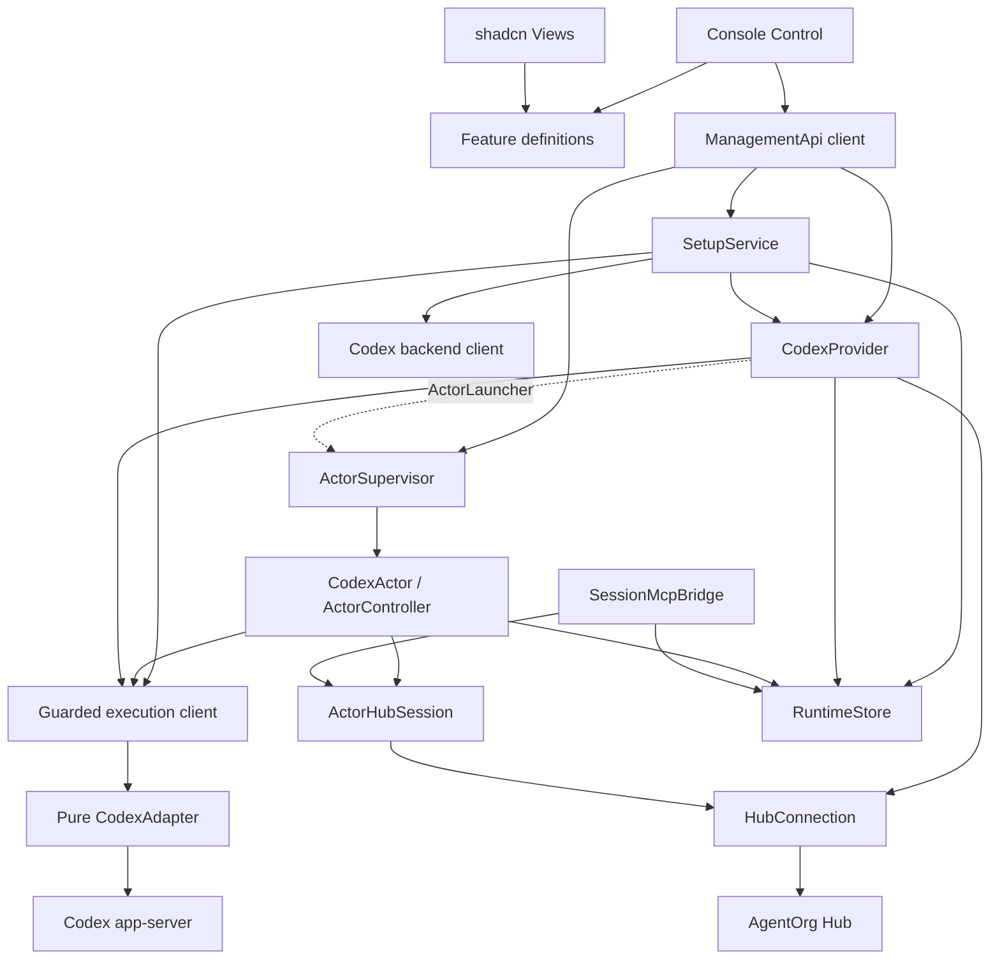

# OrgActor-Codex contracts

## Exposure

One server/container serves the Managing Console and ManagementApi directly. Deployment owns external access. The browser uses only the typed ManagementApi client and default same-origin fetch. Credentials remain private; reads return presence and fingerprints. Runtime files have mode 0600 inside a 0700 directory.

Server composition owns `{url, providerId, credential?}` through `startServer({hub})`, CLI environment, or the retained private runtime. Browser setup accepts only backend, workspace and bridge settings and rejects Hub identity fields. A fresh runtime has active Provider intent; explicit pause/suspension persists. Configured active startup awaits real Hub admission before opening HTTP. `runtime.ready` reflects current active admission, including later connection loss. Unconfigured, unreachable and rejected states expose a diagnostic console without claiming Provider readiness. Native backend readiness remains a separate setup observation. Failed startup invokes the normal shutdown path for its owned Provider, Actor supervisor, native backend and HTTP listener and leaves no autonomous Provider retry.

The public Hub checkpoint is AgentOrg `426abca58bb806f0fead1abbd6ddd89ac82fb889`, `@agentorg/cli` 0.0.2 with Workspace 0.0.2, the flat organization; its immutable package and digest are retained under `test/fixtures`. Provider and Actor initiate independent `/connection` WebSockets. Admission is JSON-RPC 2.0 `connection.connect({providerId,credential?})` or `{actorId,credential?}` and returns `{connectionId}`. Identities already exist in the Hub. Each Actor initializes an MCP client after admission and consumes the Tools the Hub exposes to that Actor. The Actor peer implements no MCP server or remote control interfaces. Provider connections implement `provider.describe({}) -> {configSchema}` and `provider.createActor({actorId,credential?,config}) -> {actorId}`. No additional handshake fields or Provider routing are used. Activity is an ordinary Tool for every open Actor; discovery follows the actual catalog without a fixed Tool count.

Hub owns organizational identity, state, the person and authority. Provider owns execution. The private `(hub URL, providerId, actorId) -> native threadId` journal is recovery policy, not a Hub lifetime binding. Creation persists accepted inputs before native effects. Identical retries reconcile; different inputs return CREATION_CONFLICT. Lost replies leave PROVISIONING_UNKNOWN without automatic native creation replay. Provider starts the independent Actor Hub peer before native creation so native MCP discovery can finish while `thread/start` is still pending. Creation names the session `AgentOrg <actorId>`, which saves it, and files it under the workspace folder's Codex project, creating that project when there is none. Naming and filing are best effort: a refusal leaves the working session as it is. The returned native identity binds onto that same controller, Hub connection and creating native adapter. Input is refused until binding and initial reconciliation finish. Provisioning success requires actual native session setup, accepted per-thread bridge configuration and durable private bootstrap handoff. Actor admission, MCP readiness and model activity remain independent observations: held Actor admission does not prevent a successful native creation reply. Hub's combined 45-second creation budget does not cancel or replay accepted work.

Initial execution configuration is a strict object: optional `model` (an available backend model); the native session is offered the whole Hub catalog. Every session starts and resumes with `sandbox: danger-full-access` and `approvalPolicy: never`, one setting in the session settings: full access to this Mac, network included, with no native prompts. Permission gating comes back through the Hub. The configured workspace root is the execution cwd. No arbitrary model instructions, credentials or native configuration overrides cross this factory boundary, so the bridge's fixed server instruction is the only guidance a provisioned Actor receives: its Actor, its authority and the `agentorg` skill's report (one Work per workstream with its progress steps, the asks on it with a recommended option, and its submission).

Failed or uncertain native creation disables the private bootstrap and its MCP capability, closes the prepared Actor peer and cancels its reconnect. The accepted journal and private bootstrap remain for reconciliation; an identical factory retry returns that retained outcome without another native creation.

## Actor execution

An Actor's only boundary with the world outside it is the interfaces its Hub exposes to it. How it drives work forward from what those interfaces give it, including Codex's app server, its sessions and its prompts, is internal to this Provider.

The Hub exposes Tools explicitly. This Provider's Actors consume that catalog and advertise no `run`, `status`, `steer`, `interrupt`, approval or terminal interfaces. The separate Provider factory RPC remains available on its Provider connection. Native coding sessions are a private implementation choice of this executor; Hub Actor identity does not require one.

Native work begins through a local console input or the Actor's own inbox, which reads `attention {since, wait: 600}` from this executor's delivered-through position. Work given to the Actor or changed by its requester, an answer to its submission, an answer to its ask, a Message to it, an ask routed to it, and a submission of Work it requested become native input: `turn/start` when idle, steering when a turn runs, and the next turn when the running turn waits on a native request or refuses the steer. An answer carries its ask and the Work it blocks; a Message carries its conversation from the Actor's own last message, one per sender. Each item's input receipt (`kind:recordID:at`) is durable before the position advances, so a restart re-reads after the position; repeated items use existing receipts, and unknown native outcomes require reconciliation and are never replayed automatically. The Workspace keeps no delivery state. A new Actor's position starts at the Hub's current one when it first connects, not at 0, and a position the Hub never issued restarts from now. See [delivery and recovery](recovery.md).

Local steering retains its input provenance. An explicit refusal is a durable failed input; retrying its identity returns the same typed error, including after the target turn completes or the executor restarts. Steering completes only after its own native user-message client ID is observed. A shared target turn ID alone cannot settle an uncertain steering input during completion or recovery.

## ManagementApi

Runtime Zod schemas are shared with the inferred browser types. `/api/state` returns sanitized settings, configuration revision, setup reports, Provider observation and Actor snapshots. `/api/setup` accepts backend/workspace/bridge settings; `/api/setup/probes/:stage` runs backend/account/desktop/bridge/Hub checks. `/api/setup/login` explicitly starts/cancels one native login owned by SetupService. `/api/provider` sets enabled intent. `/api/actors` attaches an existing Hub Actor using private bootstrap; it never creates Hub identity, and `DELETE /api/actors/:id` detaches one. The guided setup reads its steps at `/api/setup/guide`; `POST /api/setup/guide/check` checks again from scratch. `PUT /api/setup/guide/codex` starts Codex's app server on this Mac and makes it the backend. `PUT /api/setup/guide/folder {path}` chooses the workspace folder and `POST /api/setup/guide/folder` creates it. The API answers only requests whose Host names 127.0.0.1, localhost or [::1], so a page whose name was rebound to this machine can't drive it (`HOST_NOT_ALLOWED`). Actor-scoped endpoints submit input, steer, interrupt, list/terminate native background terminals and respond to scoped pending requests. Errors use stable codes and sanitized messages.

Readiness is `unconfigured`, `unreachable`, `rejected` or `ready` from explicit probes with timestamps and configuration revisions. Configuration changes invalidate affected observations. No result is equivalent to a successful probe. Setup guides the saved exact root.

Backend closure invalidates the owned pending initialization as well as the current connection. A late initializer cannot publish an old adapter, close a newer transport or clear a newer connection attempt after Setup changes configuration.

Managed native sessions request the legacy persisted history contract used by recovery. Before the first user message, the backend can explicitly report that this exact thread is not materialized. That specific native code/message is recognized only for its matching full-history request; an idle legacy metadata read with the same identity and empty preview confirms initial empty history. Unsupported paginated history, other rejections and inconsistent metadata remain errors. Execution admission reads metadata for the model provider without requiring history hydration. Presentation naming is independent of readiness.

`thread/start` already subscribes its creating connection. A fresh unmaterialized thread cannot be resumed from a rollout that does not yet exist. Initial reconciliation keeps that subscription only on the exact adapter that successfully created the identity, with the same bridge URL/capability, verified empty idle legacy history and zero accepted inputs. Submitting any start or steering request removes that adapter's initial ownership eligibility before the native request is sent. Cold adapters, foreign identities and previously accepted or uncertain inputs use ordinary `thread/resume`; missing rollout remains a failure. Startup failures retain the first phase, sanitized code and native method/code in private bootstrap state, without native error text. Neither initial readiness nor recovery sends a synthetic message, renames a thread or changes native settings; only creation names and files one.

## Guided setup on this Mac

When this Provider runs on a Mac, Setup guides one path: Codex on this Mac, through Codex's own app server. GuideService checks only what the Provider needs to run, in order: Hub admission, Codex on this Mac, the ChatGPT account, the workspace folder, the Actor, and the Actor's tools. Each step reports `done`, `missing`, `broken` or `waiting` with a stable code and the facts behind it; a step waits while an earlier one isn't done. The server checks the steps every 10 seconds whether or not a console is open. Passed live checks are reused for 30 seconds; failed ones run again on every check. A person acts only where a step says so, in the console; no step asks anything of Codex Desktop.

**Codex on this Mac** finds `codex` in ChatGPT.app's bundle, then on `PATH`. On the person's confirmation it runs `codex app-server daemon start`, as Codex Desktop does, and makes the app server's control socket, `~/.codex/app-server-control/app-server-control.sock`, the backend. While that is the backend, every connect runs the same start first, a no-op while the app server runs, and resolves the socket's link again, so the Provider follows an app server that restarted at a new path. The step is done once the app server initializes.

**The workspace folder** is the Provider's workspace root. A folder whose own `.codex/config.toml` defines `mcp_servers.org`, AgentOrg's Codex adapter, is refused when chosen, since Codex refuses the Actor's session there. The folder is created on the person's click. The step files it as a Codex project (`project/list`, else `project/create` under the key `agentorg:<folder>`, so a retry returns the same project); if Codex can't, the step still passes and says so. It is ready once an ephemeral `thread/start` with the Actor's exact settings succeeds and is unsubscribed; a session already created there stands in for that preflight. Attaching an Actor waits for this step (`SETUP_INCOMPLETE`).

The guide's setup changes run one at a time, pause the Provider around the change, and are refused while Actors or journal records are bound. A folder path must be absolute and in its plain form, with no trailing slash or control characters. Detach forgets an Actor here: its bootstrap and its journal. Its Hub identity and native session stay, so it can be attached again, and setup can change once nothing is bound.

## Codex Desktop

Codex Desktop is an optional viewer. Creation names an Actor's session `AgentOrg <actorId>`, which saves it, and files it under the folder's project (`thread/metadata/update`). Whether Desktop's sidebar lists it there isn't established: Desktop also keeps its own project assignments. Codex lets one process write a session: the app server that runs the Actor holds it, so Desktop's own app server can't resume it and Desktop shows "This is open in another app". No setup step, gate or Actor state depends on Desktop. An Actor's work is visible through the Hub.

## Module contracts and layout

| Directory                               | Contract and owned state                                                                                               | Dependencies                                                                  |
| --------------------------------------- | ---------------------------------------------------------------------------------------------------------------------- | ----------------------------------------------------------------------------- |
| `src/server`                            | Composition, HTTP/static serving, shutdown.                                                                            | All public module clients.                                                    |
| `src/management`                        | Validation, redacted projections, routes.                                                                              | Setup, Provider, Supervisor clients.                                          |
| `src/setup`                             | Connectivity, one login owner, account/quota, bridge/Hub probes; the guided this-Mac steps, checked in the background. | RuntimeStore, native protocol probes, HubConnection, local `codex` and files. |
| `src/codex`                             | Pure session/turn/event/request/terminal execution over Codex's app server.                                            | Native app-server transport.                                                  |
| `src/provider`                          | Provider RPC, durable provisioning journal, private bootstrap handoff, Detach.                                         | HubConnection, CodexAdapter, RuntimeStore, ActorLauncher.                     |
| `src/actors`                            | Supervisor; independent ActorHubSession, SessionMcpBridge, ActorController, durable inputs/position.                   | HubConnection, CodexAdapter, RuntimeStore.                                    |
| `src/hub`                               | Admission and Actor MCP client; validated Tool aliases.                                                                | WebSocket and MCP SDK.                                                        |
| `src/runtime`                           | Atomic private persistence and secret material.                                                                        | Filesystem.                                                                   |
| `web/src/{control,features,views,data}` | Control -> feature definition <- view; API client; shadcn parts.                                                       | ManagementApi only.                                                           |

Modules depend on the clients of their dependencies. CodexActor has no Provider dependency. Setup/auth/root alignment never enters ActorController or CodexProvider's execution adapter. The backend is Codex's app server, reached at a Unix socket, loopback WebSocket or TLS WebSocket listener. It never uses `codex exec`.

SetupService exposes a guarded execution client at composition. Each start/steer reads the live backend account, confirms included plan usage, and verifies the thread's OpenAI provider before forwarding to the pure adapter. API-key, missing, unknown and unavailable account/quota observations refuse model work. A previous successful setup probe grants no continuing admission. Managed sessions pin `modelProvider=openai`, disable model-provider fallback, and set per-thread `forced_login_method=chatgpt`, the documented [native authentication restriction](https://learn.chatgpt.com/docs/config-file/config-reference). Login remains a single explicitly started SetupService operation.

The dependency graph uses module clients; the dotted edge is the launcher trigger bound by Server:

The native bridge uses SDK HTTP MCP sessions for request/cancellation ownership. Every HTTP request authenticates its Actor capability and session owner; Tool handlers resolve the current ActorController after reconnect. HTTP mcp-session-id is distinct from native _meta.sessionId. SDK session termination and Provider shutdown cancel pending requests. SessionMcpBridge uses an independent Actor-scoped capability and never sends a Hub credential to Codex. The session's `org` server sets `default_tools_approval_mode: "approve"`, so Codex calls its Tools without a native prompt; Hub authority governs them. It validates Hub `agentorg/tool` metadata and forwards every interface the Hub offers the Actor. Known credential-bearing `actor_create` results are projected using their actual structured contract, storing credentials privately and regenerating model-visible text. It does not heuristically scrub arbitrary valid results. Listing and invocation preserve aliases, Tool identity and schemas. The correct Actor capability permits discovery before native identity binding. Execution requires a nonempty bound thread, the session ID read from that native thread, and a call ID matching an observed in-progress org MCP item for the current turn and requested alias. Item/turn completion, reconciliation, native disconnection and controller closure invalidate that call binding. Reconciliation restores active MCP items from authoritative native history. It fences late reads against newer turns and reconciliations, and preserves completed call/turn facts against delayed starts or stale history. Native MCP supplies threadId, sessionId and callId; the item's native event supplies its turn. No inbound Hub invocation or cause is required. An otherwise matching request can wait up to 20 seconds for its exact native item because MCP HTTP and native events travel independently. Cancellation, deadline, reconciliation, disconnect or controller close ends that wait without dispatch. Identity and current-turn scope are checked again immediately before Hub dispatch.

Codex never asks under `approvalPolicy: never`. A request it still sends, whether an approval, a question for the user or an MCP elicitation, is declined at once with its typed decline that grants nothing, and an unknown kind is refused. No turn waits on a person, and no native prompt reaches the Hub or the console. SetupService starts login only on an explicit operator action. Operator attachment does not imply organizational root identity.

Management snapshots distinguish unavailable native observation from an observed idle session. Pausing an Actor connection disconnects observation/Hub delivery and preserves native execution; interrupt and registered-terminal termination remain separate, scoped operations. Native user-message client IDs correlate recovery; text markers confer no identity. Current Hub calls carry no inbound Actor-call cause. Historical private receipt causes remain stored without propagation.

## Verification

Unit/integration tests cover eager and held startup admission, pause/reconnect, rejected/unreachable/unconfigured states, independent credentials, write-only projections, 0600 persistence, journal conflict/unknown behavior, real catalog dispatch, provenance, `attention` delivery, steering and reconnect deduplication, full-catalog presentation, native bridge identity and declined native requests. Browser E2E covers direct opening, setup/operations, failure/empty states, desktop/mobile layout and screenshots. Clean install, format/lint, build, tests and container startup use matching pinned CI runtimes.

The opt-in real E2E runs an isolated Hub at the pinned revision and this module, using an authenticated Codex app server in the proof directory and an owned session/workspace. It verifies Provider factory -> private handoff -> Actor admission -> native model/Hub MCP roundtrip, steering, interruption, reconnect/restart, scoped terminal cleanup and app catalog/history updates. Pre/post inventories and quota evidence are retained without secrets. Existing proof sessions/services/configuration are preserved. Supported app catalog/history observation and rendered pixels are reported separately. Only owned resources are deleted, and no merge or deployment occurs.
