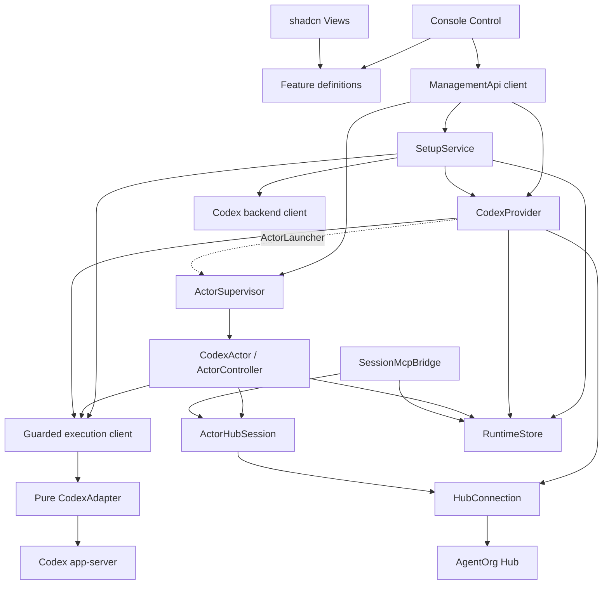

# OrgActor-Codex contracts

## Exposure

One server/container serves the Managing Console and ManagementApi directly. Deployment owns external access. The browser uses only the typed ManagementApi client and default same-origin fetch. Credentials remain private; reads return presence and fingerprints. Runtime files have mode 0600 inside a 0700 directory.

Server composition owns `{url, providerId, credential?}` through `startServer({hub})`, CLI environment, or the retained private runtime. Browser setup accepts only backend, workspace and bridge settings and rejects Hub identity fields. A fresh runtime has active Provider intent; explicit pause/suspension persists. Configured active startup awaits real Hub admission before opening HTTP. `runtime.ready` reflects current active admission, including later connection loss. Unconfigured, unreachable and rejected states expose a diagnostic console without claiming Provider readiness. Native backend and Desktop readiness remain separate setup observations. Failed startup invokes the normal shutdown path for its owned Provider, Actor supervisor, native backend and HTTP listener and leaves no autonomous Provider retry.

The public Hub checkpoint is AgentOrg PR 55, source `cca137062a9c2d979d134da9a191739d9fefe9c4`; its immutable package and digest are retained under `test/fixtures`. Provider and Actor initiate independent `/connection` WebSockets. Admission is JSON-RPC 2.0 `connection.connect({providerId,credential?})` or `{actorId,credential?}` and returns `{connectionId}`. Identities already exist in the Hub. Each Actor initializes an MCP client after admission and consumes the Tools the Hub exposes to that Actor. The Actor peer implements no MCP server or remote control interfaces. Provider connections implement `provider.describe({}) -> {configSchema}` and `provider.createActor({actorId,credential?,config}) -> {actorId}`. No additional handshake fields or Provider routing are used. Activity is an ordinary Tool for every open Actor; discovery follows the actual catalog without a fixed Tool count.

Hub owns organizational identity, state, management relationships and authority. Provider owns execution. The private `(hub URL, providerId, actorId) -> native threadId` journal is recovery policy, not a Hub lifetime binding. Creation persists accepted inputs before native effects. Identical retries reconcile; different inputs return CREATION_CONFLICT. Lost replies leave PROVISIONING_UNKNOWN without automatic native creation replay. Provider starts the independent Actor Hub peer before native creation so native MCP discovery can finish while `thread/start` is still pending. The returned native identity binds onto that same controller, Hub connection and creating native adapter. Input is refused until binding and initial reconciliation finish. Provisioning success requires actual native session setup, accepted per-thread bridge configuration and durable private bootstrap handoff. Actor admission, MCP readiness and model activity remain independent observations: held Actor admission does not prevent a successful native creation reply. Hub's combined 45-second creation budget does not cancel or replay accepted work.

Initial execution configuration is a strict object: optional `model` (an available backend model), optional `approvalAuthority` (`desktop` by default, or `hub`). The configured workspace root is the execution cwd. No arbitrary model instructions, credentials or native configuration overrides cross this factory boundary.

Failed or uncertain native creation disables the private bootstrap and its MCP capability, closes the prepared Actor peer and cancels its reconnect. The accepted journal and private bootstrap remain for reconciliation; an identical factory retry returns that retained outcome without another native creation.

## Actor execution

The Hub exposes Tools explicitly. This Provider's Actors consume that catalog and advertise no `run`, `status`, `steer`, `interrupt`, approval or terminal interfaces. The separate Provider factory RPC remains available on its Provider connection. Native coding sessions are a private implementation choice of this executor; Hub Actor identity does not require one.

Native work begins through a local console input or the Actor's own inbox policy. The Actor reads its Hub inbox, durably accepts each message identity, and then acknowledges delivery. Repeated messages use the same accepted input. Unknown native outcomes require reconciliation and are never replayed automatically. A Hub message is an input to local policy rather than an execution command from a reverse MCP server.

Local steering retains its input provenance. An explicit refusal is a durable failed input; retrying its identity returns the same typed error, including after the target turn completes or the executor restarts. Steering completes only after its own native user-message client ID is observed. A shared target turn ID alone cannot settle an uncertain steering input during completion or recovery.

## ManagementApi

Runtime Zod schemas are shared with the inferred browser types. `/api/state` returns sanitized settings, configuration revision, setup reports, Provider observation and Actor snapshots. `/api/setup` accepts backend/workspace/bridge settings; `/api/setup/probes/:stage` runs backend/account/desktop/bridge/Hub checks. `/api/setup/login` explicitly starts/cancels one native login owned by SetupService. `/api/provider` sets enabled intent. `/api/actors` attaches an existing Hub Actor using private bootstrap; it never creates Hub identity. Actor-scoped endpoints submit input, steer, interrupt, list/terminate native background terminals and respond to scoped pending requests. Errors use stable codes and sanitized messages.

Readiness is `unconfigured`, `unreachable`, `rejected` or `ready` from explicit probes with timestamps and configuration revisions. Configuration changes invalidate affected observations. No result is equivalent to a successful probe. Desktop root/catalog alignment and rendered Desktop visibility are separate evidence; native thread creation or persistence alone establishes neither Desktop claim. Setup guides the saved exact root and records factual mapping observations.

Backend closure invalidates the owned pending initialization as well as the current connection. A late initializer cannot publish an old adapter, close a newer transport or clear a newer connection attempt after Setup changes configuration.

Managed native sessions request the legacy persisted history contract used by recovery. Before the first user message, the backend can explicitly report that this exact thread is not materialized. That specific native code/message is recognized only for its matching full-history request; an idle legacy metadata read with the same identity and empty preview confirms initial empty history. Unsupported paginated history, other rejections and inconsistent metadata remain errors. Execution admission reads metadata for the model provider without requiring history hydration. Presentation naming is independent of readiness.

`thread/start` already subscribes its creating connection. A fresh unmaterialized thread cannot be resumed from a rollout that does not yet exist. Initial reconciliation keeps that subscription only on the exact adapter that successfully created the identity, with the same bridge URL/capability, verified empty idle legacy history and zero accepted inputs. Submitting any start or steering request removes that adapter's initial ownership eligibility before the native request is sent. Cold adapters, foreign identities and previously accepted or uncertain inputs use ordinary `thread/resume`; missing rollout remains a failure. Startup failures retain the first phase, sanitized code and native method/code in private bootstrap state, without native error text. Neither initial readiness nor recovery sends a synthetic message, renames a thread or changes native settings.

## Module contracts and layout

| Directory                               | Contract and owned state                                                                                | Dependencies                                              |
| --------------------------------------- | ------------------------------------------------------------------------------------------------------- | --------------------------------------------------------- |
| `src/server`                            | Composition, HTTP/static serving, shutdown.                                                             | All public module clients.                                |
| `src/management`                        | Validation, redacted projections, routes.                                                               | Setup, Provider, Supervisor clients.                      |
| `src/setup`                             | Connectivity, one login owner, account/quota, Desktop root mapping, bridge/Hub probes.                  | RuntimeStore, native protocol probes, HubConnection.      |
| `src/codex`                             | Pure session/turn/event/request/terminal execution; SSH and local socket adapters share native framing. | Native app-server transport.                              |
| `src/provider`                          | Provider RPC, durable provisioning journal, private bootstrap handoff.                                  | HubConnection, CodexAdapter, RuntimeStore, ActorLauncher. |
| `src/actors`                            | Supervisor; independent ActorHubSession, SessionMcpBridge, ActorController, durable inputs/cursors.     | HubConnection, CodexAdapter, RuntimeStore.                |
| `src/hub`                               | Admission and Actor MCP client; validated Tool aliases.                                                 | WebSocket and MCP SDK.                                    |
| `src/runtime`                           | Atomic private persistence and secret material.                                                         | Filesystem.                                               |
| `web/src/{control,features,views,data}` | Control -> feature definition <- view; API client; shadcn parts.                                        | ManagementApi only.                                       |

Modules depend on the clients of their dependencies. CodexActor has no Provider dependency. Setup/auth/root alignment never enters ActorController or CodexProvider's execution adapter. Both SSH and co-located app-server adapters are supported, with SSH first in container setup. SSH uses strict host verification and `codex app-server proxy`; co-located mode connects an existing Unix/WebSocket app-server listener. Neither path uses `codex exec`.

SetupService exposes a guarded execution client at composition. Each start/steer reads the live backend account, confirms included plan usage, and verifies the thread's OpenAI provider before forwarding to the pure adapter. API-key, missing, unknown and unavailable account/quota observations refuse model work. A previous successful setup probe grants no continuing admission. Managed sessions pin `modelProvider=openai`, disable model-provider fallback, and set per-thread `forced_login_method=chatgpt`, the documented [native authentication restriction](https://learn.chatgpt.com/docs/config-file/config-reference). Login remains a single explicitly started SetupService operation.

The dependency graph uses module clients; the dotted edge is the launcher trigger bound by Server:

The native bridge uses SDK HTTP MCP sessions for request/cancellation ownership. Every HTTP request authenticates its Actor capability and session owner; Tool handlers resolve the current ActorController after reconnect. HTTP mcp-session-id is distinct from native _meta.sessionId. SDK session termination and Provider shutdown cancel pending requests. SessionMcpBridge uses an independent Actor-scoped capability and never sends a Hub credential to Codex. It validates Hub `agentorg/tool` metadata and forwards only the Actor's offered interfaces. Known credential-bearing `actor_create` results are projected using their actual structured contract, storing credentials privately and regenerating model-visible text. It does not heuristically scrub arbitrary valid results. Listing and invocation preserve aliases, Tool identity and schemas. The correct Actor capability permits discovery before native identity binding. Execution requires a nonempty bound thread, the session ID read from that native thread, and a call ID matching an observed in-progress org MCP item for the current turn and requested alias. Item/turn completion, reconciliation, native disconnection and controller closure invalidate that call binding. Reconciliation restores active MCP items from authoritative native history. It fences late reads against newer turns and reconciliations, and preserves completed call/turn facts against delayed starts or stale history. Native MCP supplies threadId, sessionId and callId; the item's native event supplies its turn. No inbound Hub invocation or cause is required. An otherwise matching request can wait up to 20 seconds for its exact native item because MCP HTTP and native events travel independently. Cancellation, deadline, reconciliation, disconnect or controller close ends that wait without dispatch. Identity and current-turn scope are checked again immediately before Hub dispatch.

Desktop-observe is the conservative default: it never starts login or answers native approval/input requests. SetupService starts login only on an explicit operator action. Hub-governed approval uses a pending request bound to thread, turn, request ID and authorized answerer. One timeout owner controls each request; stale/resolved responses are rejected. Operator attachment does not imply organizational root identity.

Hub-governed requests ask the current manager with that manager as the designated answerer. The durable binding includes exact reviewed scope and native IDs. Permission questions show the requested filesystem paths, network scope and reason; grants use that same scope for the current turn. A lost question-creation reply is reconciled against matching authenticated Hub questions before any answer is applied. No match or multiple matches remain uncertain and issue no duplicate question. Native request expiry/resolution owns cancellation. Replaced/revoked connections stop autonomous retries and require explicit resume.

Management snapshots distinguish unavailable native observation from an observed idle session. Pausing an Actor connection disconnects observation/Hub delivery and preserves native execution; interrupt and registered-terminal termination remain separate, scoped operations. Native user-message client IDs correlate recovery; text markers confer no identity. Current Hub calls carry no inbound Actor-call cause. Historical private receipt causes remain stored without propagation.

## Verification

Unit/integration tests cover eager and held startup admission, pause/reconnect, rejected/unreachable/unconfigured states, independent credentials, write-only projections, 0600 persistence, journal conflict/unknown behavior, real catalog dispatch, provenance, local inbox/reconnect deduplication, native bridge identity and approval ownership. Browser E2E covers direct opening, setup/operations, failure/empty states, desktop/mobile layout and screenshots. Clean install, format/lint, build, tests and container startup use matching pinned CI runtimes.

The opt-in real E2E runs an isolated Hub at the pinned revision and this module, using the authenticated shared SSH backend and an owned session/workspace. It verifies Provider factory -> private handoff -> Actor admission -> native model/Hub MCP roundtrip, steering, interruption, reconnect/restart, scoped terminal cleanup and app catalog/history updates. Pre/post inventories and quota evidence are retained without secrets. Existing proof sessions/services/configuration are preserved. Supported app catalog/history observation and rendered pixels are reported separately. Only owned resources are deleted, and no merge or deployment occurs.
