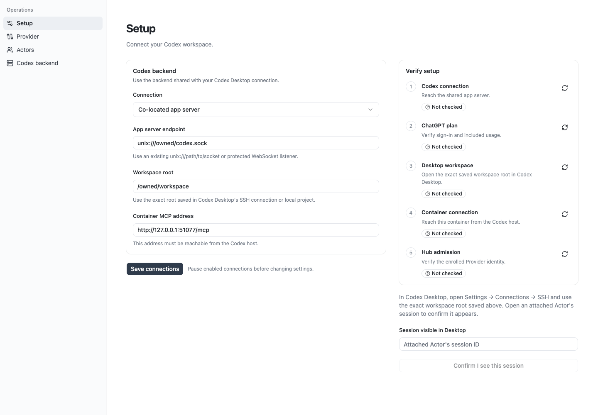
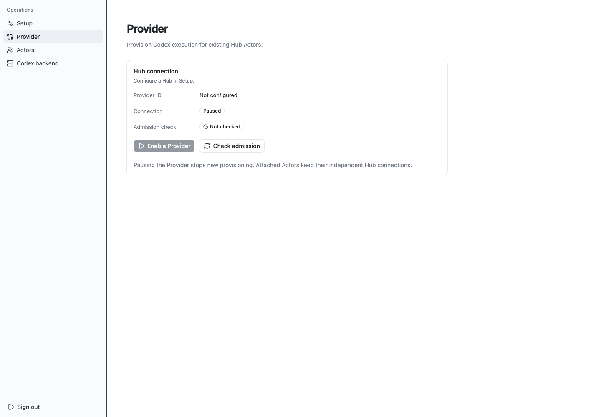
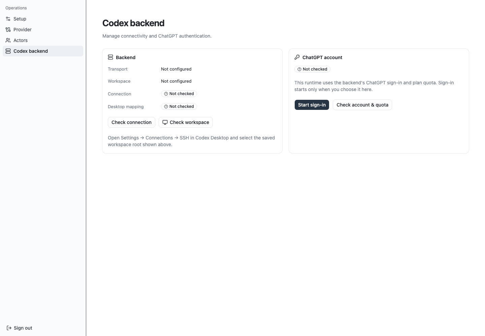
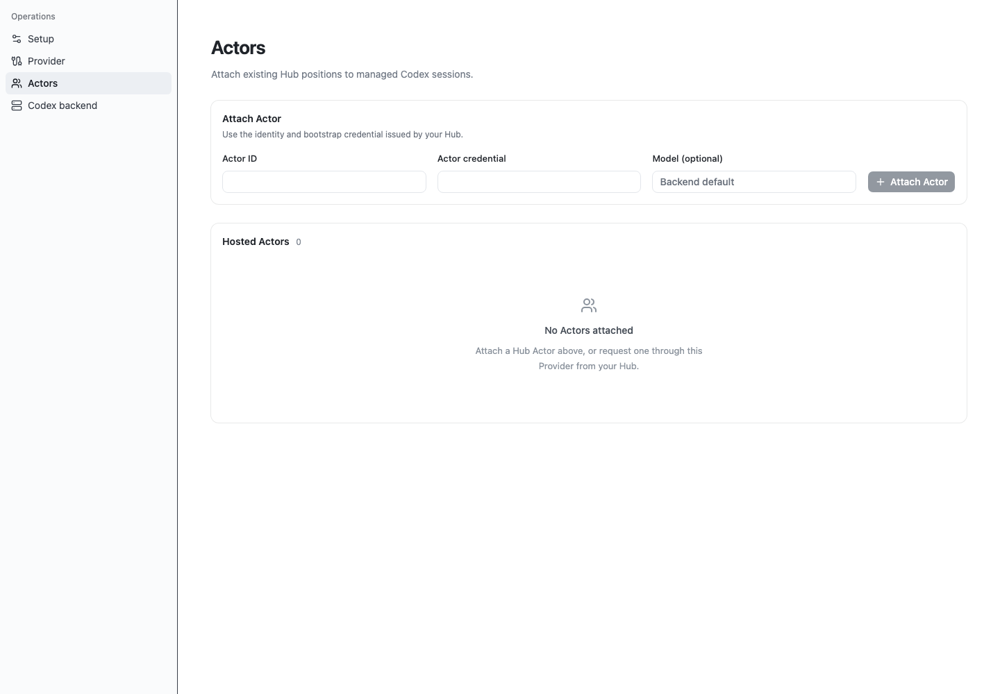
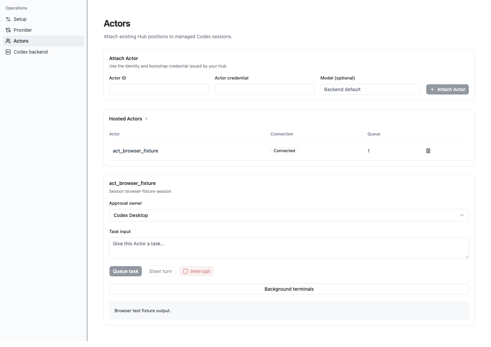
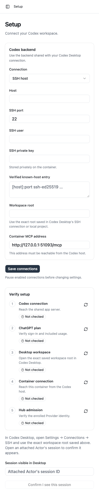
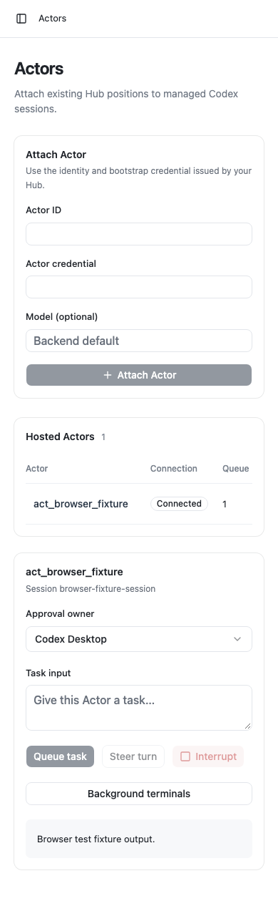

# Verification

The local candidate passes clean installation, format/lint, build and 41 regression tests on Node 22.22.0 and 24.22.1. Steering regressions cover durable refusal/retry and require native input-ID correlation before uncertain steering can complete. Backend lifecycle regressions hold native initialization across fresh Setup reconfiguration in both completion orders. Native-protocol regressions establish first-use readiness without naming or model work, retain materialized input IDs, and reject unrelated or inconsistent history failures. Seven browser tests exercise the assembled HTTP console, direct opening and plain same-origin requests, write-only setup, factual readiness, Actor controls, terminal controls and mobile navigation. Lifecycle tests use isolated loopback Hub mocks and fake credentials, hold admission before startup resolves, and exercise persisted pause, optional credential omission, explicit reconnect, failure states and immutable retained bindings. An occupied HTTP port verifies failed startup releases its admitted Provider, schedules no reconnect and permits an explicit fresh start. No live native sessions or model turns were used for this access/composition change. Historical native proof below remains labeled with its source checkpoints. Browser captures reset scroll and check sidebar geometry and unreachable vertical clipping.

Live first-use diagnosis at `c7065e6` exposed the backend's default paginated history returning `list_turns is not supported yet`. Two authorized disposable native probes ran without model turns or Tool calls, and both were archived. The explicit legacy probe reported the scoped pre-first-message unmaterialized state; the corrected read and metadata-only admission guard passed on that same unnamed probe. New managed sessions request legacy history, and only that exact native state plus matching idle legacy metadata establishes initial empty history. Existing unsupported paginated history remains an error. The harness now checks native history and MCP readiness before its presentation rename. Earlier model/control runs renamed the session before readiness, so they do not establish untouched first-use readiness.

The final SSH run tested source checkpoint `f28eb06300e8c98e1a1fc82b8a6317a2b73d3489`. It completed on 2026-10-30 with two actual native Hub MCP calls, `ORGACTOR_MCP_OK`, its own native steering client ID and a durable applied/completed receipt containing `STEER_APPLIED`. Execution progressed to a separate interrupted command, and reconnect duplicated no input. Included plan usage was allowed before and after; its reported primary window remained at 27%. The [native report](../evidence/native-e2e.json), [supported app observation](../evidence/desktop-app-observation.json) and [cleanup manifest](../evidence/cleanup-manifest.json) contain the sanitized observations. Only the newest idle proof is retained; the prior owned proof was verified idle with zero terminals before archival. The [earlier SSH report](../evidence/history/948a58c/native-e2e.json) and [co-located setup report](../evidence/colocated-setup.json) remain labeled with their tested `948a58c` source checkpoint.

## Proof boundaries

| Surface                                     | Evidence                                                                                                                                                                                                                                          |
| ------------------------------------------- | ------------------------------------------------------------------------------------------------------------------------------------------------------------------------------------------------------------------------------------------------- |
| Hub factory and independent Actor admission | Real isolated Hub at `58dbececc84289f378f658b35504371106a7c760`; describe/create remain callable after repeated active admission checks.                                                                                                          |
| Native SSH execution                        | Real ChatGPT-plan model roundtrip through actor-scoped `org.team` and `org.activity`; native-applied steering marker, a separate interrupted command and reconnect with no duplicated input. Final run details are in `evidence/native-e2e.json`. |
| Co-located adapter                          | Native Unix-socket setup-only run, including offline Actor provisioning and thread-specific MCP discovery; no model turn.                                                                                                                         |
| Desktop app                                 | Supported app catalog/history observation of the retained owned proof. Rendered Desktop pixels are unverified.                                                                                                                                    |
| Console browser                             | Screenshots below; Actor-control images use the explicitly labeled browser fixture. They establish UI behavior/layout, independently of native E2E evidence.                                                                                      |
| Container                                   | Local Docker daemon is unavailable. CI builds and starts the container; the PR checks show its result. The live native flow runs as the Node server on the host.                                                                                  |

## Console captures

## Retention and repeatability

Start/build/setup commands are in [README](../README.md). The private runtime is a required recovery volume; publishing or copying it is unnecessary for review. The opt-in harness records pre/post native inventories and plan quota and fails if cleanup leaves unresolved owned work. One explicitly retained idle proof is classified separately and recorded in `evidence/cleanup-manifest.json`. Old canonical SSH proof infrastructure and existing AgentOrg services are preserved.

Sanitized evidence, screenshots, the dependency graph and run instructions are also persisted outside worktrees in the delivery's owned evidence directory. That bundle excludes RuntimeStore, SSH keys, authentication files and raw logs. Final commit, PR and CI run URLs are recorded in the durable handoff report.
