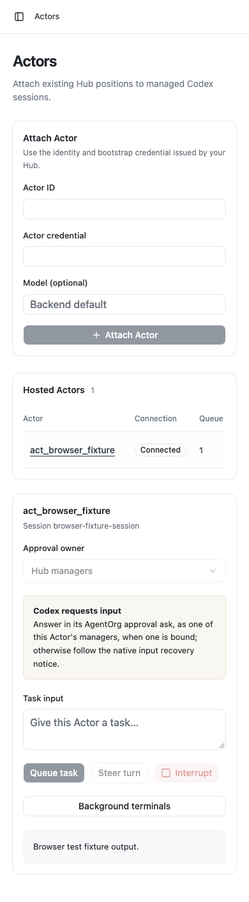

# Verification

The model-free compatibility suite pins public Hub source `15095614bf09086a476930eafa764dbc15bf45cb`, package SHA256 `6b17567dcb5505b37ad7856f16fb457d225c2dd98363672f266aac4b239b2aad`. Tests launch its public CLI against owned empty homes and import only public Actor/contract SDK exports. The 11-Tool/30-interface catalog includes Workspace 0.5.0, and every interface carries its level tag. Assembled first-use cases exercise Provider describe/createActor, pre-binding MCP discovery, a Message delivered through `attention` as native work with its conversation, current-turn HTTP dispatch, a native question answered once through an approval ask that only a manager can answer and that resolves on the answer, organization-wide ask reads and role refusals. Retired question/progress/message receipt interfaces and reverse Actor controls are refused.

Both native delivery-order cases hold the fake native turn/start response while an MCP HTTP request reaches the production bridge. They then deliver either the delayed item or delayed turn and item. The original request succeeds once its exact native identity is observed, without retry, inbound Hub invocation or cause. Authoritative history restores in-progress native MCP bindings without replaying notifications. Terminal item/turn history and observed completions take precedence over delayed starts or stale in-progress reads; a delayed read cannot overwrite newer turn observation or a newer reconciliation. Separate tests cover cancellation, a bounded observation deadline, disconnect/reconciliation/closure cleanup, stale identity and scope ending between observation and dispatch. The native HTTP bridge uses SDK MCP sessions so cancellation notifications reach the original request. Tests cancel a real HTTP request, deliver its native item later and require zero dispatch; they also reject cross-Actor HTTP session reuse, follow a replacement ActorController and terminate a pending session without later dispatch. Capability authorization, credential projection and ask-role checks remain enforced.

Assembled lifecycle fixtures retain native creation ownership, block input before binding, start a new Actor's position when it first connects, preserve unknown accepted input and retire failed creation peers without replay. Delivery tests cover a failed save and restart without lost or duplicated input, a missing or unissued position starting from now, steering a running turn, the next turn for a turn waiting on a native request or refusing the steer, an answer with its ask and Work, a Message with its conversation from the Actor's own last message, and the answer to the Provider's own approval ask staying out of model input. Approval tests cover lost ask creation and uncertain native answer attempts; typed permission/input validation and stale/terminal scope checks remain. A bridge test presents each level's interfaces by the Hub's tags and carries the report guidance. Representative private rows preserve historical receipts and old question bindings with inert defaults; they do not establish complete current live-corpus readability. These fixtures make no real native requests or model turns. Seven browser tests use the local assembled server with owned private homes.

Generated-code negative controls exercise removal of native identity authorization and HTTP bridge registration. Their failure evidence is retained outside the checkout and their mutations are restored.

The real execution and cross-service reports below are historical evidence for their named source revisions. Earlier Hub-dispatched Actor controls are not the current execution contract.

Live first-use diagnosis at `c7065e6` exposed the backend's default paginated history returning `list_turns is not supported yet`. Two authorized disposable native probes ran without model turns or Tool calls, and both were archived. The explicit legacy probe reported the scoped pre-first-message unmaterialized state; the corrected read and metadata-only admission guard passed on that same unnamed probe. New managed sessions request legacy history, and only that exact native state plus matching idle legacy metadata establishes initial empty history. Existing unsupported paginated history remains an error. The harness now checks native history and MCP readiness before its presentation rename. Earlier model/control runs renamed the session before readiness, so they do not establish untouched first-use readiness.

The final SSH run tested source checkpoint `f28eb06300e8c98e1a1fc82b8a6317a2b73d3489`. It completed on 2026-10-30 with two actual native Hub MCP calls, `ORGACTOR_MCP_OK`, its own native steering client ID and a durable applied/completed receipt containing `STEER_APPLIED`. Execution progressed to a separate interrupted command, and reconnect duplicated no input. Included plan usage was allowed before and after; its reported primary window remained at 27%. The [native report](../evidence/native-e2e.json), [supported app observation](../evidence/desktop-app-observation.json) and [cleanup manifest](../evidence/cleanup-manifest.json) contain the sanitized observations. Only the newest idle proof is retained; the prior owned proof was verified idle with zero terminals before archival. The [earlier SSH report](../evidence/history/948a58c/native-e2e.json) and [co-located setup report](../evidence/colocated-setup.json) remain labeled with their tested `948a58c` source checkpoint.

## Proof boundaries

| Surface                                     | Evidence                                                                                                                                                                                                                                          |
| ------------------------------------------- | ------------------------------------------------------------------------------------------------------------------------------------------------------------------------------------------------------------------------------------------------- |
| Hub factory and independent Actor admission | Real isolated Hub at `58dbececc84289f378f658b35504371106a7c760`; describe/create remain callable after repeated active admission checks.                                                                                                          |
| Native SSH execution                        | Real ChatGPT-plan model roundtrip through actor-scoped `org.team` and `org.activity`; native-applied steering marker, a separate interrupted command and reconnect with no duplicated input. Final run details are in `evidence/native-e2e.json`. |
| Co-located adapter                          | Native Unix-socket setup-only run, including offline Actor provisioning and thread-specific MCP discovery; no model turn.                                                                                                                         |
| Desktop app                                 | Supported app catalog/history observation of the retained owned proof. Rendered Desktop pixels are unverified.                                                                                                                                    |
| Console browser                             | Screenshots below; Actor-control images use the explicitly labeled browser fixture. They establish UI behavior/layout, independently of native E2E evidence.                                                                                      |
| Container                                   | Local Docker daemon is unavailable. CI builds and starts the container; the PR checks show its result. The live native flow runs as the Node server on the host.                                                                                  |

## Console captures

## Retention and repeatability

Start/build/setup commands are in [README](../README.md). The private runtime is a required recovery volume; publishing or copying it is unnecessary for review. The opt-in harness records pre/post native inventories and plan quota and fails if cleanup leaves unresolved owned work. One explicitly retained idle proof is classified separately and recorded in `evidence/cleanup-manifest.json`. Old canonical SSH proof infrastructure and existing AgentOrg services are preserved.

Sanitized evidence, screenshots, the dependency graph and run instructions are also persisted outside worktrees in the delivery's owned evidence directory. That bundle excludes RuntimeStore, SSH keys, authentication files and raw logs. Final commit, PR and CI run URLs are recorded in the durable handoff report.
