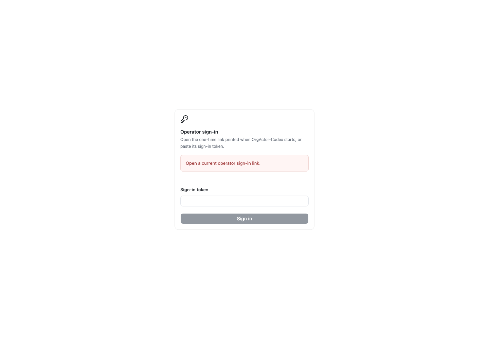

# Verification

The local candidate passes clean installation, format/lint, build and 30 regression tests on Node 22.22.0 and 24.22.1. The final steering regressions cover durable refusal/retry and require native input-ID correlation before uncertain steering can complete. Seven browser tests exercise the assembled HTTP console, authentication, write-only setup, factual readiness, Actor controls, terminal controls and mobile navigation. Browser captures reset scroll and check sidebar geometry and unreachable vertical clipping.

The final live runs tested source checkpoint `948a58ce4215d9c606f629d7f5cd119e41cacb06`. The SSH run completed on 2026-10-30 with two actual native Hub MCP calls, `ORGACTOR_MCP_OK`, native-applied `STEER_APPLIED`, a separate interrupted command and no duplicated inputs after reconnect. Included plan usage was allowed before and after; its reported primary window remained at 26%. The [native report](../evidence/native-e2e.json), [co-located setup report](../evidence/colocated-setup.json), [supported app observation](../evidence/desktop-app-observation.json) and [cleanup manifest](../evidence/cleanup-manifest.json) contain the sanitized observations.

## Proof boundaries

| Surface                                     | Evidence                                                                                                                                                                                                                                          |
| ------------------------------------------- | ------------------------------------------------------------------------------------------------------------------------------------------------------------------------------------------------------------------------------------------------- |
| Hub factory and independent Actor admission | Real isolated Hub at `58dbececc84289f378f658b35504371106a7c760`; describe/create remain callable after repeated active admission checks.                                                                                                          |
| Native SSH execution                        | Real ChatGPT-plan model roundtrip through actor-scoped `org.team` and `org.activity`; native-applied steering marker, a separate interrupted command and reconnect with no duplicated input. Final run details are in `evidence/native-e2e.json`. |
| Co-located adapter                          | Native Unix-socket setup-only run, including offline Actor provisioning and thread-specific MCP discovery; no model turn.                                                                                                                         |
| Desktop app                                 | Supported app catalog/history observation of the retained owned proof. Rendered Desktop pixels are unverified.                                                                                                                                    |
| Console browser                             | Screenshots below; Actor-control images use the explicitly labeled browser fixture. They establish UI behavior/layout, independently of native E2E evidence.                                                                                      |
| Container                                   | Local Docker daemon is unavailable. CI builds and starts the container; the PR checks show its result. The live native flow runs as the Node server on the host.                                                                                  |

## Console captures

## Retention and repeatability

Start/build/setup commands are in [README](../README.md). The private runtime is a required recovery volume; publishing or copying it is unnecessary for review. The opt-in harness records pre/post native inventories and plan quota and fails if cleanup leaves unresolved owned work. One explicitly retained idle proof is classified separately and recorded in `evidence/cleanup-manifest.json`. Old canonical SSH proof infrastructure and existing AgentOrg services are preserved.

Sanitized evidence, screenshots, the dependency graph and run instructions are also persisted outside worktrees in the delivery's owned evidence directory. That bundle excludes RuntimeStore, SSH keys, authentication files and raw logs. Final commit, PR and CI run URLs are recorded in the durable handoff report.
